# AC Light Bulb Project

This project is a simple Arduino-based smart light control system. It uses an IR remote, an IR receiver, and a relay module to switch an AC light bulb on and off.

The main goal is to build a practical device that can be controlled from a distance using an ordinary IR remote control.

## What this project does

- The Arduino reads IR signals from a remote control.
- It decodes the button command.
- It turns the relay ON or OFF.
- The relay switches the AC light bulb.

This makes the system useful for home automation experiments, small smart-home prototypes, or learning how remote-controlled electronics work.

## Project images and component tags

These images are part of the documentation and show every required part, the wiring layout, and the final setup.

### Main components

<div align="center">

<figure>
  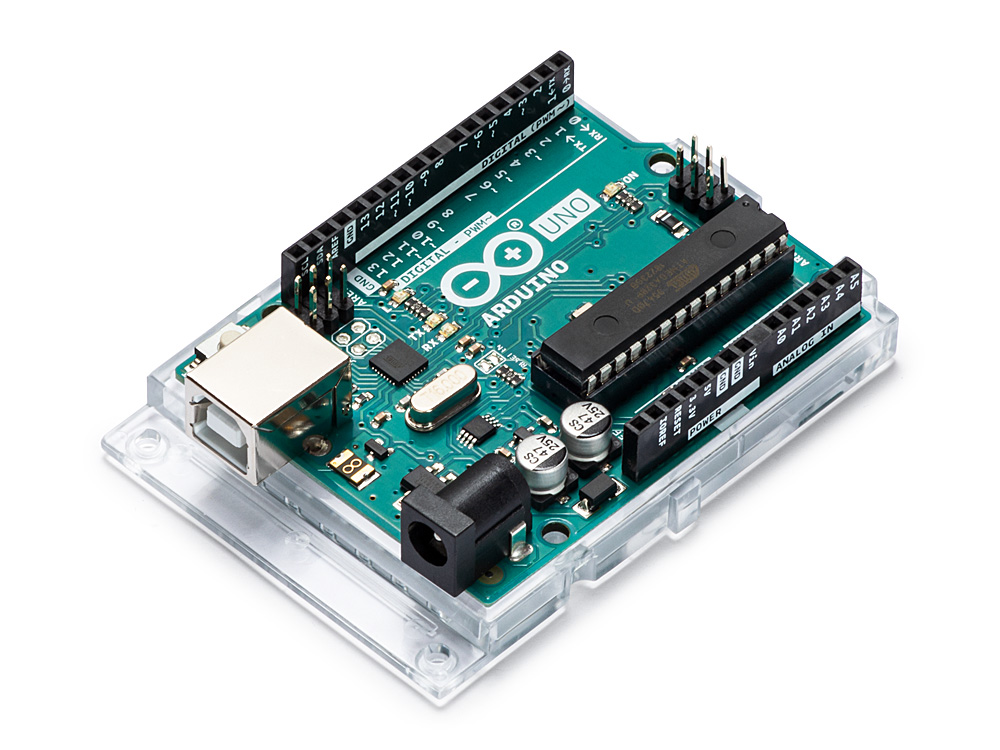
  <figcaption><strong>Tag:</strong> Arduino Uno</figcaption>
</figure>

<figure>
  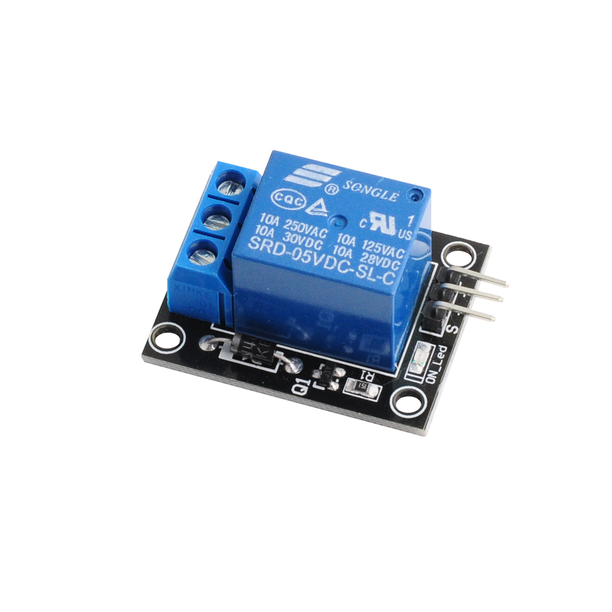
  <figcaption><strong>Tag:</strong> Relay Module</figcaption>
</figure>

<figure>
  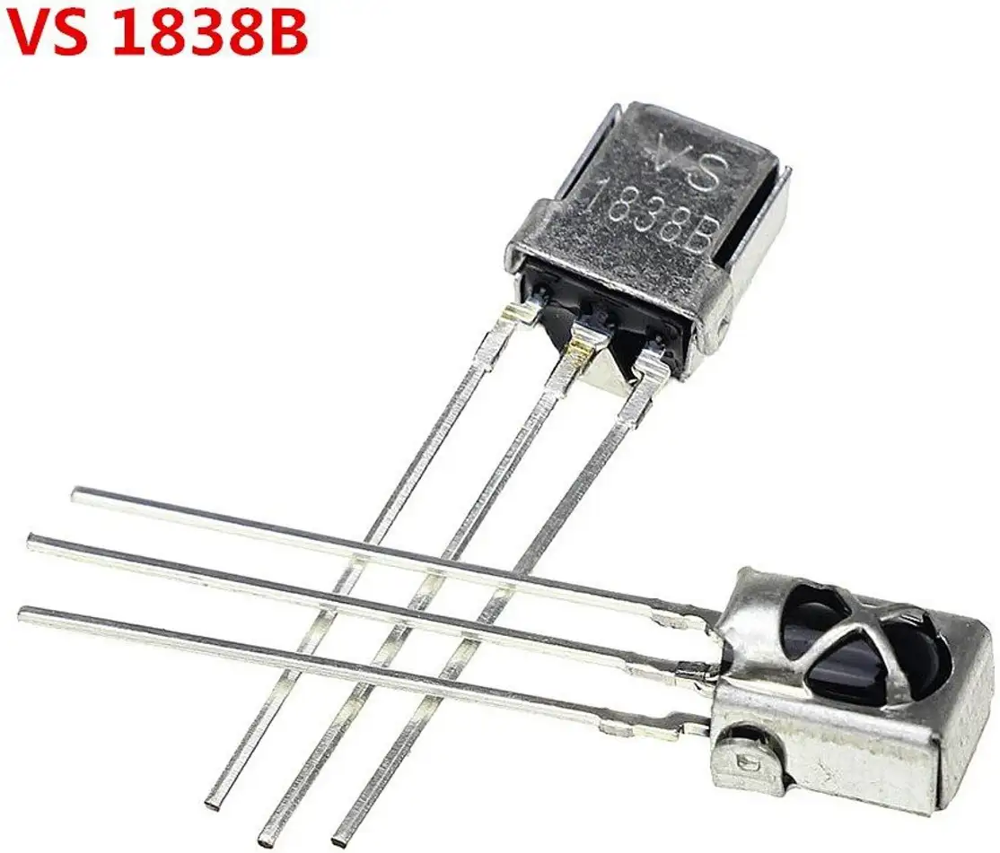
  <figcaption><strong>Tag:</strong> IR Receiver Module</figcaption>
</figure>

<figure>
  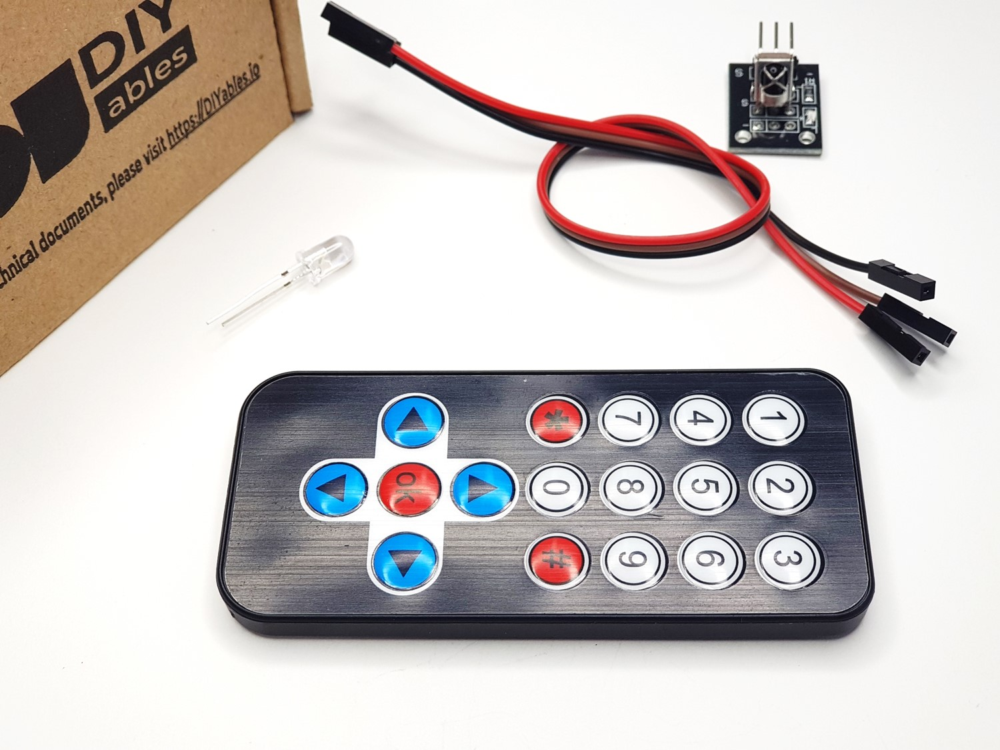
  <figcaption><strong>Tag:</strong> IR Remote Control</figcaption>
</figure>

</div>

### Supporting parts and setup images

<div align="center">

<figure>
  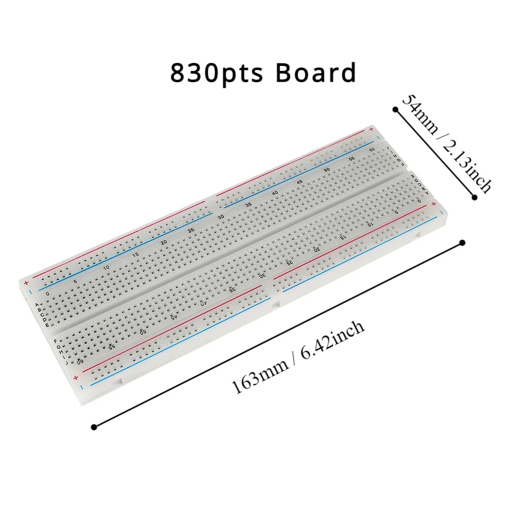
  <figcaption><strong>Tag:</strong> Breadboard</figcaption>
</figure>

<figure>
  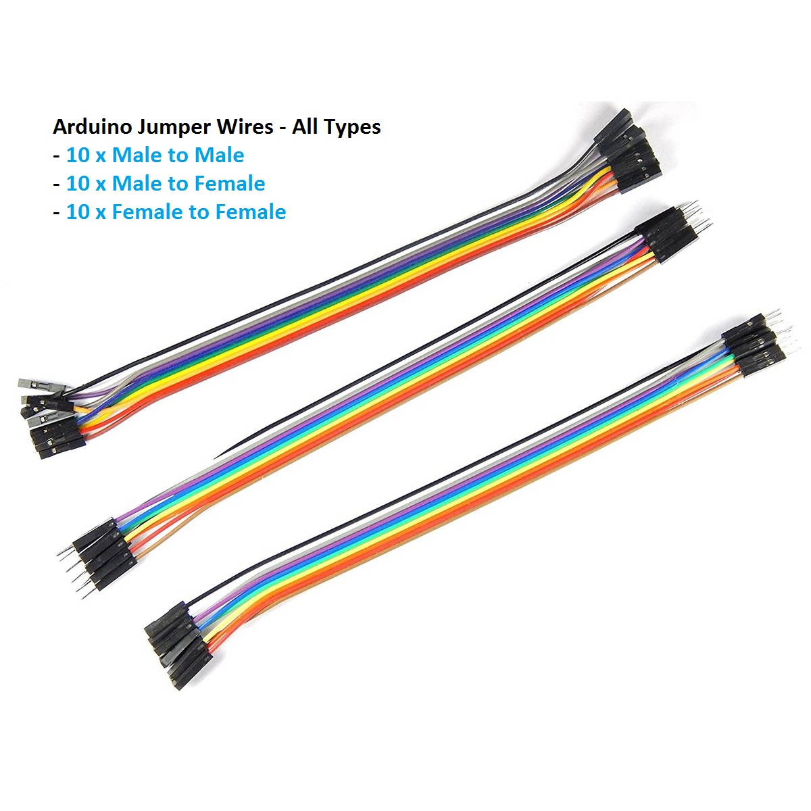
  <figcaption><strong>Tag:</strong> Jumper Wires</figcaption>
</figure>

<figure>
  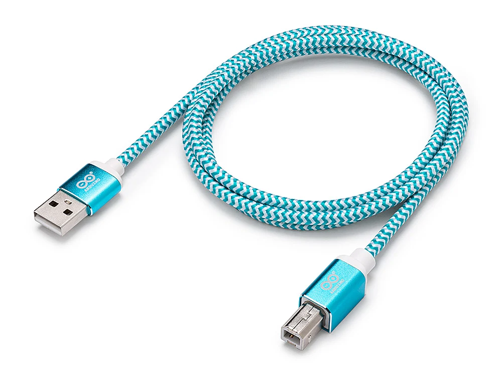
  <figcaption><strong>Tag:</strong> USB Cable</figcaption>
</figure>

<figure>
  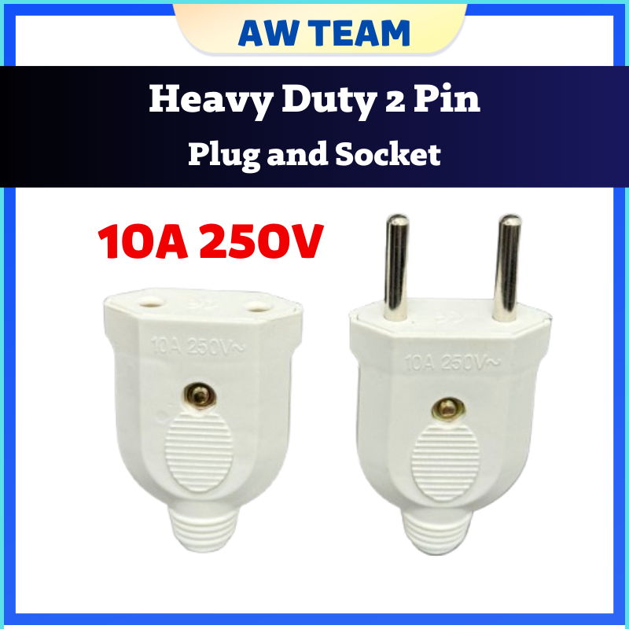
  <figcaption><strong>Tag:</strong> AC Plug Cable</figcaption>
</figure>

<figure>
  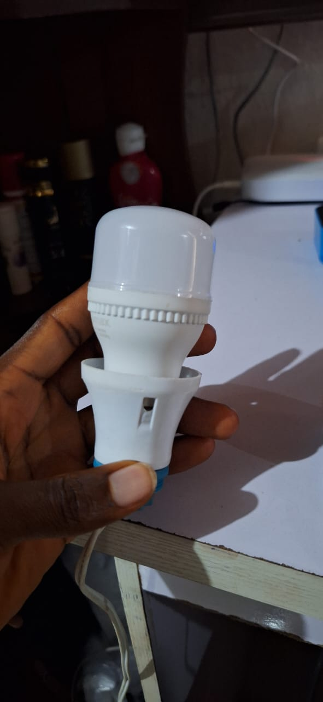
  <figcaption><strong>Tag:</strong> LED Bulb + Holder</figcaption>
</figure>

</div>

### Wiring and complete project layout

<div align="center">

<figure>
  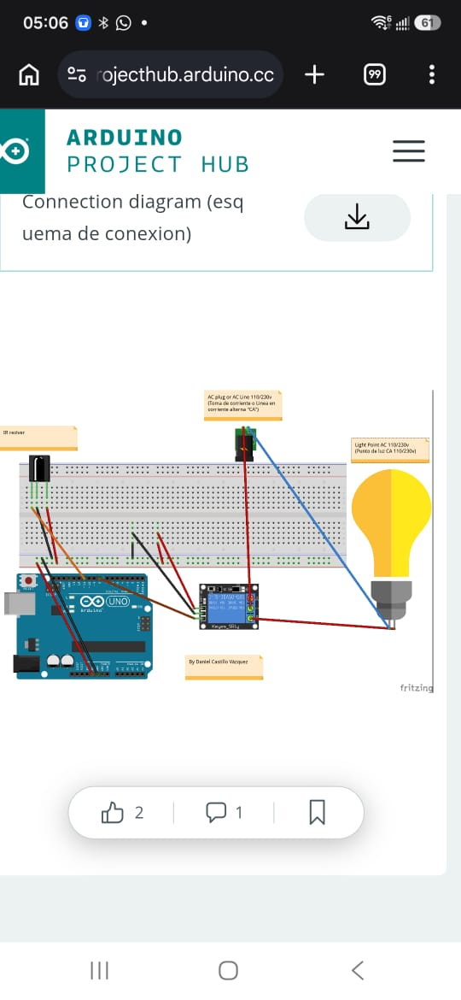
  <figcaption><strong>Tag:</strong> Circuit Diagram</figcaption>
</figure>

<figure>
  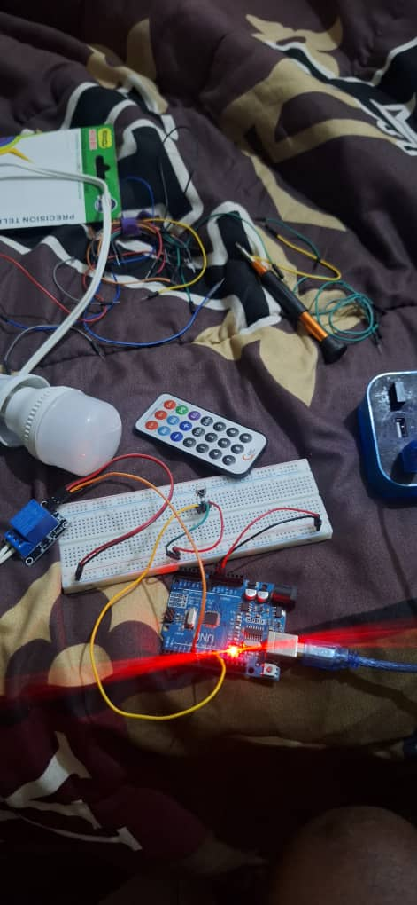
  <figcaption><strong>Tag:</strong> Full Connection Layout</figcaption>
</figure>

</div>

## Components you need

Before starting, make sure you have all of the following parts:

- Arduino Uno
- IR receiver module
- 5V relay module
- IR remote control
- AC light bulb and socket
- Connecting wires
- Breadboard or soldered wiring setup
- 5V power source for the Arduino (USB cable or adapter)
- Optional: 220 ohm resistor / transistor / protection circuit depending on your relay board design

## Wiring and connection guide

This project uses the following pin mapping:

- `IR_RECEIVE_PIN` = `11`
- `RELAY_PIN` = `7`

### Connection table

| Component | Arduino pin | Notes |
|---|---:|---|
| IR receiver OUT | `D11` | Connect to the IR receive pin |
| Relay module input | `D7` | Controls the relay state |
| IR receiver VCC | `5V` | Power for the receiver |
| IR receiver GND | `GND` | Ground |
| Relay module VCC | `5V` | Power for relay control |
| Relay module GND | `GND` | Ground |

### Practical wiring layout

```text
          +5V ------------------------ IR Receiver VCC
          GND ------------------------ IR Receiver GND
Arduino D11 --------------------- IR Receiver OUT

Arduino D7 ---------------------- Relay IN
Arduino 5V ---------------------- Relay VCC
Arduino GND --------------------- Relay GND

Relay output -------------------- AC load switch circuit
```

### Important safety note for AC wiring

This project works with AC mains power, so it is very important to be careful.

- Do not connect mains voltage directly to the Arduino.
- The Arduino and relay control side must stay low voltage.
- Only the relay contact side should be connected to the AC circuit.
- Use proper insulation, proper enclosure, and safe mains wiring practices.
- If you are not experienced with electrical work, ask a qualified technician for help.

## Step-by-step build instructions

1. Place the Arduino Uno on the worktable.
2. Connect the IR receiver module to the Arduino:
   - VCC -> `5V`
   - GND -> `GND`
   - OUT -> `D11`
3. Connect the relay module:
   - VCC -> `5V`
   - GND -> `GND`
   - IN -> `D7`
4. Make sure the relay module is properly powered.
5. Connect the relay output to the AC light circuit according to your relay module design.
6. Keep the AC wiring isolated from the Arduino board.
7. Upload the code from `AC_LIGHT_BULB_PROJECT.ino`.
8. Open the Serial Monitor at `9600` baud.
9. Point the remote at the IR receiver and press buttons.
10. Watch the command values in the serial monitor.
11. Match the received codes to the logic in the sketch.

## Code understanding

The Arduino sketch does the following:

- starts serial communication
- sets the relay pin as an output
- initializes the IR receiver
- waits for a command
- reads the command value
- checks it against known values
- changes the relay state

The file is named:

- `AC_LIGHT_BULB_PROJECT.ino`

## What the code is checking

The program uses these comparisons:

- `0x18`
- `0x0C`

When a new IR command is received, it compares it with these values. If a match is found, the relay pin is set HIGH or LOW.

## Important code note

The code comments and the actual relay actions should be reviewed carefully on the hardware.

In the current code:

- `command == 0x18` sets `RELAY_PIN` to `HIGH` and prints `BUTTON 1 -> LIGHT OFF`
- `command == 0x0C` sets `RELAY_PIN` to `LOW` and prints `BUTTON 2 -> LIGHT ON`

But the comments above them say:

- `// BUTTON 1 = LIGHT ON`
- `// BUTTON 2 = LIGHT OFF`

This means the labels and the actual relay output are inconsistent. Many relay modules are active-low, so the relay may turn ON at `LOW` and OFF at `HIGH` depending on the module. That is why the Serial Monitor and test results on the hardware are important.

Always verify the real behavior using the actual relay module before finalizing your build.

## How to test the project

1. Open the Arduino IDE.
2. Open `AC_LIGHT_BULB_PROJECT.ino`.
3. Install the `IRremote` library if needed.
4. Select the board as `Arduino Uno`.
5. Select the correct COM port.
6. Upload the code.
7. Open the Serial Monitor at `9600`.
8. Press any button on the remote.
9. Observe the printed command values.
10. Check which button changes the relay state.
11. Confirm the AC light turns ON or OFF as expected.

## Troubleshooting

### The remote does not work

- Check the IR receiver orientation.
- Confirm the receiver OUT pin is connected to `D11`.
- Make sure the receiver has power and ground.
- Try a different remote or another button.

### The relay does not switch

- Check the relay input pin is connected to `D7`.
- Confirm the relay module is receiving `5V` and `GND`.
- Check the relay board type: some are active-low, some are not.
- Verify the AC wiring is correct and safe.

### The serial monitor shows different codes

- Remote codes vary by manufacturer.
- Use the serial output to find the actual button codes.
- Update the code values to match your remote.

### The AC light seems reversed

- Check whether your relay is active-low.
- Confirm the relay module logic.
- Use `digitalWrite(RELAY_PIN, LOW)` and `digitalWrite(RELAY_PIN, HIGH)` only after testing on the real device.

## Recommended improvement for the project

A better version of the project would include:

- named constants for button codes
- a proper ON/OFF command table
- debounce or repeat filtering
- better labels for the relay state
- an actual circuit diagram image
- a dedicated case or enclosure for safety

## File structure

- `AC_LIGHT_BULB_PROJECT.ino` — main Arduino code
- `README.md` — documentation
- `images/` — component reference images

## Safety warning

This project uses AC mains voltage. Use proper insulation and safety precautions.

- Do not touch live AC wires while the circuit is powered.
- Use a reliable relay module designed for AC switching.
- Work carefully and keep the low-voltage electronics separate from the mains wiring.
- If not fully confident, consult a professional.

## Final note

This project is a great beginner Arduino project because it combines:

- IR communication
- relay switching
- AC control
- practical home automation logic

With the images in this document and the wiring instructions above, someone should be able to understand the project and build a similar working device with care and safety.
